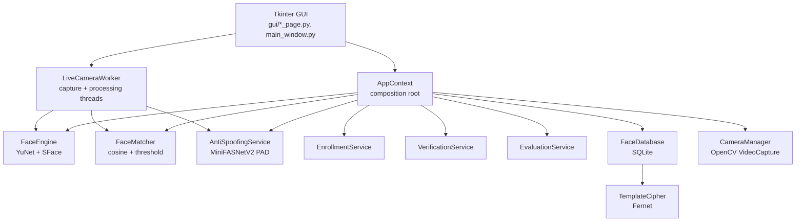

# PRESENTATION_NOTES.md

> Consolidated study and presentation notes for the **Biometric Authentication
> System** desktop app.
>
> **Source rule:** every factual claim below comes only from the repository's
> Markdown documentation. The source file is named next to each important fact.
> Anything the docs do not cover is marked **غير موثّق في ملفات الـ docs** and is
> repeated in the final **Gaps** section. No thresholds, model names, accuracy
> numbers or libraries were invented.
>
> **Files used:** `README.md`, `README.ar.md`, `docs/setup.md`,
> `docs/usage.md`, `docs/architecture.md`, `docs/security_privacy.md`,
> `docs/evaluation.md`, `docs/testing.md`, `docs/tool_selection.md`,
> `docs/anti_spoofing_summary.md`, `docs/ar/README.md`,
> `models/anti_spoofing/README.md`,
> `tests/assets/anti_spoofing/README.md`, plus `requirements.txt` only to
> confirm dependency names/versions.

---

## 1. Project overview

The project is a **local-only desktop demonstration** of face recognition and
**1:1 identity verification**, built for a **Master's-level Cybersecurity
project** on Biometric Authentication (`README.md`). It detects faces, extracts
face embeddings, compares them with a configurable cosine-similarity threshold,
and can optionally run a presentation-attack (anti-spoofing) check on the Live
Camera page (`README.md`, `docs/architecture.md`). It includes enrolment,
encrypted template storage, a user database, and an evaluation pipeline that
computes FAR/FRR (`README.md`, `docs/evaluation.md`).

The authors explicitly state it is **academic demonstration only** and **not a
production identity system**: no certified bias evaluation, no hardware-backed
key storage, and no operational threshold calibration (`README.md`). It must not
be used to protect real accounts, buildings or sensitive data (`README.md`).

Target use: a university presentation / practical demo of biometric concepts,
not real access control (`README.md`, `docs/security_privacy.md`).

---

## 2. Tech stack

| Component | Technology / Library / Model | Purpose | Source file |
|---|---|---|---|
| Language | Python 3.12 (tested Python 3.12.3) | Application runtime | `docs/setup.md`, `README.md` |
| GUI framework | Tkinter 8.6 (Python stdlib; `python3-tk` system package) | Desktop interface | `docs/setup.md`, `docs/setup.md` (system packages) |
| Camera / video | OpenCV `VideoCapture` via `opencv-contrib-python` 5.0.0.93 (tested); requirements say `>=4.8.0` | Webcam capture and image decoding | `docs/setup.md`, `docs/architecture.md`, `requirements.txt` |
| Face detection | **OpenCV YuNet** `face_detection_yunet_2023mar.onnx` (OpenCV Zoo) | Detect face bounding boxes/landmarks | `README.md`, `docs/setup.md` |
| Face recognition / embeddings | **OpenCV SFace** `face_recognition_sface_2021dec.onnx`, **128-dimensional** embedding | Alignment (`alignCrop`) + feature extraction (`feature`) | `README.md`, `docs/architecture.md`, `docs/tool_selection.md` |
| Matching | Explicit **cosine similarity** against a threshold | 1:1 verification and 1:N name labels | `docs/architecture.md`, `README.md` |
| Anti-spoofing / PAD | **MiniFASNetV2** ONNX, run with `onnxruntime` 1.31.1 (requirements `>=1.16`) | Presentation-attack detection on Live Camera | `README.md`, `models/anti_spoofing/README.md`, `docs/setup.md` |
| Storage | **SQLite** database `database/biometric.db` | Users, encrypted templates, audit log | `docs/architecture.md`, `docs/security_privacy.md` |
| Template encryption | **Fernet** (AES-128-CBC + HMAC-SHA256), key in `database/templates.key` | Encrypt embeddings at rest | `README.md`, `docs/security_privacy.md` |
| Numerics / image handling | NumPy 2.5.4, Pillow 13.0.0 (listed tested versions) | Array math and image handling (Pillow's exact role is **غير موثّق في ملفات الـ docs**) | `docs/setup.md`, `requirements.txt` |
| Testing | pytest 9.2.0 (requirements `>=7.0`) | Automated test suite | `docs/setup.md`, `docs/testing.md` |
| Packaging | `run.sh` launcher + Python `venv/` (creates venv, installs missing packages, checks models) | Local launch only; **no distributable packaging (e.g. PyInstaller) is documented** | `README.md`, `docs/setup.md` |
| Evaluation output | CSV + PNG chart (`pairs.csv`, `summary.csv`, `far_frr_chart.png`) | Metrics and FAR/FRR sweep | `docs/evaluation.md` |

**Model provenance and integrity (`README.md`, `models/anti_spoofing/README.md`):**

- YuNet and SFace are from the **OpenCV Zoo** (`README.md`).
- MiniFASNetV2 is optional and downloaded from
  `yakhyo/face-anti-spoofing` releases; original architecture/training code is
  from **minivision-ai/Silent-Face-Anti-Spoofing** (`models/anti_spoofing/README.md`).
- MiniFASNetV2 SHA-256:
  `b32929adc2d9c34b9486f8c4c7bc97c1b69bc0ea9befefc380e4faae4e463907`
  (`README.md`, `models/anti_spoofing/README.md`).
- MiniFASNetV2 size: `1,743,581` bytes (`models/anti_spoofing/README.md`).
- Both upstream projects are **Apache License 2.0** (`models/anti_spoofing/README.md`).

---

## 3. Architecture and data flow

### 3.1 Modules and how they connect

The app is a **layered desktop program** (`docs/architecture.md`):



- `config/settings.py` supplies paths, model names, quality limits and threshold
  persistence (`docs/architecture.md`).
- `core/app_context.py` is the **composition root**: it constructs the engine,
  database, cipher, matcher and services once and shares them with the GUI
  (`docs/architecture.md`).
- Module responsibilities are listed in `docs/architecture.md`: `core/face_engine.py`
  (detect/embed), `core/matcher.py` (`MatchResult`, `decide`, `FaceMatcher`),
  `core/anti_spoofing.py` (PAD loading, preprocessing, tracker, runtime),
  `core/security.py` (validation, permissions, Fernet), `core/database.py`,
  `core/enrollment.py`, `core/verification.py`, `core/evaluation.py`,
  `core/camera_manager.py`, `gui/camera_worker.py`.

### 3.2 Enrolment pipeline (`docs/architecture.md`)

```text
image/frame
  -> load_image / frame validation
  -> YuNet detect
  -> quality assessment
  -> SFace alignCrop + feature
  -> 128-D float32 embedding
  -> Fernet encrypt
  -> SQLite users table
```

The original image is **not persisted**; the database stores the encrypted
template, embedding dimension, model label, threshold, display name and timestamp
(`docs/architecture.md`, `docs/usage.md`).

### 3.3 1:1 verification pipeline (`docs/architecture.md`)

```text
probe image/frame
  -> YuNet detect
  -> SFace feature
  -> decrypt enrolled template
  -> cosine similarity
  -> similarity >= threshold ?
  -> VERIFIED / NOT VERIFIED
  -> audit event (score, threshold, source; no image or embedding)
```

The score is a **geometric similarity, not a probability** (`docs/architecture.md`,
`docs/usage.md`).

### 3.4 Live camera with optional PAD (`docs/architecture.md`, `docs/usage.md`)

```text
frame
  -> YuNet detect
  -> largest/primary face
  -> if PAD OFF: original SFace path
  -> if PAD ON:
       crop with scale 2.7 -> resize 80x80 BGR float32 (no /255)
       -> MiniFASNetV2 ONNX (every N frames)
       -> 3-class softmax: index 1 = live
       -> temporal live evidence (3 consecutive frames by default)
       -> LIVE ? SFace identity verification
       -> SPOOF / ERROR / UNCERTAIN / NO FACE ? block authentication
```

Only the **primary (largest) face** is eligible for PAD and identity verification
when PAD is ON; other faces are marked `PAD: primary only` and get no identity
label (`docs/usage.md`, `docs/anti_spoofing_summary.md`). Face changes are
detected with bounding-box **IoU** and reset the temporal evidence
(`docs/architecture.md`).

### 3.5 Step-by-step: camera frame to final decision

1. **Capture thread** continuously reads frames into a capacity-1
   `LatestFrameBuffer` (`docs/architecture.md`).
2. **Processing thread** takes only the newest frame, so inference cannot build
   a backlog (`docs/architecture.md`).
3. **YuNet** runs every `DETECTION_INTERVAL` processed frames (default 2)
   (`docs/architecture.md`, `README.md`).
4. The **largest/primary face** is selected (`docs/usage.md`,
   `docs/anti_spoofing_summary.md`).
5. If PAD is ON: crop ×2.7, resize 80×80, BGR `float32` `0..255`, run
   MiniFASNetV2 every `PAD_FRAME_INTERVAL` frames, softmax, classify
   (`models/anti_spoofing/README.md`, `docs/anti_spoofing_summary.md`).
6. **Temporal tracker** requires `PAD_REQUIRED_LIVE_FRAMES` consecutive live
   results (default 3) (`docs/anti_spoofing_summary.md`).
7. If PAD says `LIVE` (or PAD is OFF), **SFace** extracts the probe embedding;
   embeddings are cached per face region and reused for at most
   `RECOGNITION_INTERVAL` frames while IoU ≥ `FEATURE_CACHE_IOU`
   (`docs/architecture.md`).
8. **Matching**: cosine similarity against enrolled templates; 1:N best match
   for a name label, optional 1:1 verification against a selected user
   (`docs/usage.md`, `docs/architecture.md`).
9. **Decision**: accept if `similarity >= threshold` (default `0.363`)
   (`README.md`, `docs/evaluation.md`).
10. Result is published through a bounded queue; the GUI polls with `after(...)`
    and renders the latest result (`docs/architecture.md`).

### 3.6 Threading notes (`docs/architecture.md`)

- Tkinter widgets are touched only on the main thread.
- `LiveCameraWorker` uses two daemon threads (capture + processing).
- `FaceEngine` and `AntiSpoofingDetector` protect model calls with locks.
- `CameraManager` uses an `RLock`, is idempotent on release, sets
  `CAP_PROP_BUFFERSIZE` (default `2`), and records actual width/height/FPS/buffer
  size for diagnostics.
- Every SQLite operation uses a short-lived connection.

### 3.7 Database schema (`docs/architecture.md`)

```sql
CREATE TABLE users (
    user_id       TEXT PRIMARY KEY,
    display_name  TEXT NOT NULL,
    template      BLOB NOT NULL,
    embedding_dim INTEGER NOT NULL,
    model         TEXT NOT NULL,
    threshold     REAL NOT NULL,
    created_at    TEXT NOT NULL
);

CREATE TABLE audit_log (
    id          INTEGER PRIMARY KEY AUTOINCREMENT,
    created_at  TEXT NOT NULL,
    event_type  TEXT NOT NULL,
    user_id     TEXT,
    detail      TEXT NOT NULL DEFAULT ''
);
```

---

## 4. Features

### 4.1 Face detection

- **What it does (user view):** finds faces in uploaded images and webcam
  frames and draws boxes; the largest face is used for decisions
  (`docs/usage.md`, `docs/evaluation.md`).
- **How it works technically:** OpenCV YuNet detects faces; SFace aligns the
  crop (`alignCrop`) and extracts a 128-D embedding (`README.md`,
  `docs/tool_selection.md`). In the live pipeline YuNet runs every
  `DETECTION_INTERVAL` processed frames (`README.md`, `docs/architecture.md`).
- **What it uses:** YuNet `face_detection_yunet_2023mar.onnx` (`README.md`).
- **Key parameters:** `FACE_DETECTION_INTERVAL` default `2`;
  `FACE_DETECTION_MAX_WIDTH` default `0` (native resolution);
  `FACE_OPENCV_THREADS` default `min(2, CPUs)` (`README.md`). YuNet's internal
  confidence/NMS thresholds are **غير موثّق في ملفات الـ docs**.
- **ON/OFF behavior:** not applicable (always active).
- **Limitations:** small faces may be missed if detection is downscaled; the
  docs say to set `FACE_DETECTION_MAX_WIDTH=320` only when latency matters more
  than small-face accuracy (`README.md`). Multiple faces: the largest face is
  used for evaluation; enrolment uses the **first detected** face
  (`docs/evaluation.md`, `docs/usage.md`).
- **Live demo:** open **Compare Two Images** with a clear frontal photo; or
  start **Live Camera** and show boxes following the face
  (`docs/usage.md`).

### 4.2 Photo vs live camera discrimination (liveness / PAD)

- **What it does (user view):** on **Live Camera**, with
  **Anti-Spoofing Protection** ON, the app tries to tell a live face from a
  printed photo or a screen replay, and blocks authentication when it thinks the
  face is not live (`README.md`, `docs/usage.md`).
- **How it works technically:** the primary face is cropped with scale `2.7`,
  resized to `80x80`, kept as BGR `float32` in `0..255` (**no /255**), and passed
  to MiniFASNetV2. The model returns 3 logits; softmax is applied; class index
  `1` is live, indices `0` and `2` are presentation attacks. A temporal tracker
  requires several consecutive live results before SFace runs
  (`models/anti_spoofing/README.md`, `docs/anti_spoofing_summary.md`).
- **What it uses:** MiniFASNetV2 ONNX via `onnxruntime`
  (`README.md`, `models/anti_spoofing/README.md`).
- **Key parameters/thresholds:** `live_score >= 0.80` → `LIVE`;
  `spoof_score >= 0.60` → `SPOOF`; otherwise `UNCERTAIN`
  (`docs/anti_spoofing_summary.md`). Raising the live threshold makes acceptance
  stricter; lowering the spoof threshold makes spoof rejection more sensitive
  (the docs describe these as uncalibrated defaults,
  `docs/anti_spoofing_summary.md`).
- **ON vs OFF:** **OFF** = original YuNet + SFace path, no PAD inference; a static
  photograph or screen replay can still produce a match (`docs/usage.md`).
  **ON** = fail-closed: spoof, uncertain, error, no-face or face-change blocks
  SFace and sets `verified = False` (`docs/anti_spoofing_summary.md`,
  `docs/usage.md`). If the model or `onnxruntime` is missing, an explicit error
  is shown and authentication stays blocked while ON (`README.md`,
  `docs/usage.md`).
- **Limitations:** not a certified PAD; no guarantee against masks, 3D masks,
  advanced replay, deepfakes or adversarial perturbations; thresholds are not
  calibrated; no demographic bias evaluation; no APCER/BPCER/ACER measurement
  (`docs/anti_spoofing_summary.md`). PAD is applied **only** on the Live Camera
  page; static-image paths, enrolment from camera, verification from camera,
  Compare Images and the Security-page demo do **not** apply PAD
  (`docs/anti_spoofing_summary.md`).
- **Live demo:** show a live face → `LIVE FACE` then `VERIFIED`; show a printed
  photo or a phone screen → `AUTH BLOCKED` / `SPOOF DETECTED`; cover the face →
  `NO FACE` / `HOLD STILL` (`docs/anti_spoofing_summary.md`,
  `docs/testing.md`).

### 4.3 Anti-spoofing toggle (ON/OFF)

- **What it does (user view):** a checkbox **Anti-Spoofing Protection** on the
  Live Camera page; it can be toggled without restarting the camera
  (`README.md`, `docs/usage.md`).
- **How it works technically:** when enabled, MiniFASNetV2 loads in the
  background; Start is disabled until loading finishes. The worker reads the
  runtime state and handles changes. When PAD blocks, the cached SFace embedding
  is cleared so an old template cannot be reused (`docs/usage.md`,
  `docs/anti_spoofing_summary.md`).
- **What it uses:** MiniFASNetV2 + `onnxruntime` (`README.md`).
- **Key parameters:** `FACE_PAD_LIVE_THRESHOLD=0.80`,
  `FACE_PAD_SPOOF_THRESHOLD=0.60`, `FACE_PAD_REQUIRED_LIVE_FRAMES=3`,
  `FACE_PAD_FRAME_INTERVAL=2`, `FACE_PAD_FACE_IOU_THRESHOLD=0.35`,
  `FACE_PAD_THREADS=1`; fixed constants `PAD_CROP_SCALE=2.7`,
  `PAD_INPUT_SIZE=80x80`, `PAD_CLASS_LIVE_INDEX=1`
  (`docs/anti_spoofing_summary.md`).
- **ON vs OFF behavior:** detailed in 4.2. OFF adds no PAD inference; ON blocks
  authentication on any non-live result (`docs/architecture.md`,
  `docs/anti_spoofing_summary.md`).
- **Limitations:** anyone with UI access can turn it off; no enforced policy,
  roles or admin password; no automatic model-integrity verification; the
  documented SHA-256 is not checked at load time (`docs/anti_spoofing_summary.md`).
- **Live demo:** tick the box during a running camera and show that behavior
  changes without a restart; untick and show the original path returns
  (`docs/usage.md`, `docs/testing.md`).

### 4.4 Compare Two Images

- **What it does (user view):** compares two photographs without enrolment and
  shows cosine similarity, threshold and `MATCH` / `NO MATCH`
  (`docs/usage.md`).
- **How it works technically:** each image is loaded, checked for a face and
  previewed; only the largest detected face is used; SFace embeddings are
  compared by cosine similarity (`docs/usage.md`).
- **What it uses:** YuNet + SFace + cosine matcher (`docs/usage.md`,
  `docs/architecture.md`).
- **Key parameters:** the shared threshold (default `0.363`); supported formats
  `.jpg`, `.jpeg`, `.png`, `.bmp`, `.webp`, `.tif`, `.tiff` (`docs/usage.md`,
  `README.md`).
- **ON/OFF behavior:** no PAD on this path (`docs/anti_spoofing_summary.md`).
- **Limitations:** the score is not a probability; a still photo can be compared
  freely; no liveness check (`docs/usage.md`).
- **Live demo:** compare two photos of the same person (expect `MATCH`), then two
  different people (expect `NO MATCH`); optionally save annotated copies under
  `results/` (`docs/usage.md`).

### 4.5 Register User (Enrolment)

- **What it does (user view):** creates a local user from an uploaded image or a
  webcam frame (`README.md`, `docs/usage.md`).
- **How it works technically:** validate user ID/name, require consent, detect a
  face, run a quality check, extract an SFace 128-D embedding, encrypt it with
  Fernet, and insert it into SQLite (`docs/architecture.md`, `docs/usage.md`).
- **What it uses:** YuNet, SFace, Fernet, SQLite (`docs/architecture.md`).
- **Key parameters/rules:** user ID must start with a letter or number and may
  contain letters, numbers, dot, dash or underscore, up to 64 characters;
  display name up to 80 characters; consent is mandatory; quality rejects faces
  smaller than 80 px, very blurry faces, and faces too dark or too bright
  (`docs/usage.md`, `docs/security_privacy.md`). The exact blur/brightness
  numeric thresholds are **غير موثّق في ملفات الـ docs**.
- **ON/OFF behavior:** no PAD; enrolment from an image or from the camera does
  not pass through `pad_runtime` (`docs/anti_spoofing_summary.md`).
- **Limitations:** if several faces are present, the **first detected** face is
  used, so one clear face is recommended; duplicate user IDs are rejected; the
  original photo is not stored (`docs/usage.md`).
- **Live demo:** register a test user from an image, then show the metadata in
  **User Database** (`docs/testing.md`).

### 4.6 Verify Identity (1:1)

- **What it does (user view):** compares a probe image or webcam frame against
  one selected enrolled user and shows similarity, threshold and decision
  (`docs/usage.md`).
- **How it works technically:** detect face → SFace embedding → decrypt enrolled
  template → cosine similarity → `similarity >= threshold` → `VERIFIED` /
  `NOT VERIFIED` → audit event (`docs/architecture.md`).
- **What it uses:** YuNet + SFace + cosine matcher + Fernet + SQLite
  (`docs/architecture.md`).
- **Key parameters:** shared threshold (default `0.363`) (`README.md`).
- **ON/OFF behavior:** no PAD on this path; the docs state verification from
  camera uses the camera worker but without PAD
  (`docs/anti_spoofing_summary.md`).
- **Limitations:** success does **not** prove the person is physically present or
  that the image is live; a no-face probe is `NOT VERIFIED`; low-quality probes
  still get a score with a warning (`docs/usage.md`).
- **Live demo:** verify the same person's image and a different person's image
  (`docs/testing.md`).

### 4.7 Live Camera (identification + optional verification)

- **What it does (user view):** live preview with face boxes, FPS, name labels
  for enrolled faces, optional 1:1 verification against a selected user, and
  optional anti-spoofing (`docs/usage.md`).
- **How it works technically:** every detected face is compared with all
  enrolled templates; the best cosine similarity above threshold gets the display
  name, otherwise `Unknown`. Optionally the largest face gets a 1:1 score
  (`docs/usage.md`).
- **What it uses:** OpenCV `VideoCapture`, YuNet, SFace, matcher, optional
  MiniFASNetV2 (`docs/usage.md`, `docs/architecture.md`).
- **Key parameters:** `FACE_CAMERA_BUFFERSIZE=2`,
  `FACE_DETECTION_INTERVAL=2`, `FACE_RECOGNITION_INTERVAL=2`,
  `FACE_FEATURE_CACHE_IOU=0.5`, `FACE_PREVIEW_REFRESH_MS=33`,
  `FACE_DIAGNOSTICS=0` (`README.md`). Recognition interval is clamped to at
  least the detection interval (`README.md`).
- **ON/OFF behavior:** with PAD ON only the primary face is verified; with PAD
  OFF all detected faces get the original labels (`docs/usage.md`,
  `docs/anti_spoofing_summary.md`).
- **Limitations:** the name label is **open-set 1:N identification**, not proof of
  identity; false matches become more likely as enrolled users grow; restart the
  camera after adding a user so the new template is loaded (`docs/usage.md`,
  `docs/security_privacy.md`).
- **Live demo:** start camera, show `Unknown` then a known enrolled face, then
  enable PAD and repeat (`docs/testing.md`).

### 4.8 Responsive camera pipeline / performance

- **What it does (user view):** keeps the GUI responsive during inference and
  offers optional diagnostics (`README.md`).
- **How it works technically:** dedicated capture thread + processing thread +
  capacity-1 latest-frame buffer; YuNet every second frame by default; SFace
  embeddings reused for at most two frames while the same face region persists
  (`README.md`, `docs/architecture.md`).
- **What it uses:** Python threads, OpenCV, `core/frame_buffer.py`,
  `core/diagnostics.py` (`docs/architecture.md`).
- **Key parameters:** the `FACE_*` variables in the table above; setting
  `FACE_DIAGNOSTICS=1` shows capture/process FPS, YuNet/SFace/PAD timings, frame
  latency, CPU, RAM and dropped frames (`README.md`, `docs/usage.md`).
- **ON/OFF behavior:** PAD scheduling is unchanged by the detection/recognition
  cadence (`README.md`).
- **Limitations:** numbers are environment-specific; docs report about
  **15 results/s** actual-camera throughput on the development machine with
  roughly half the process CPU versus the original single-threaded worker
  (`README.md`, `docs/testing.md`). These are not guarantees.
- **Live demo:** run `FACE_DIAGNOSTICS=1 ./run.sh` and show the diagnostics row
  updating (`docs/testing.md`).

### 4.9 User Database

- **What it does (user view):** lists, searches and deletes enrolled users;
  shows metadata and non-biometric audit events (`README.md`, `docs/usage.md`).
- **How it works technically:** SQLite `users` and `audit_log` tables; deletion
  removes the encrypted template and writes an audit event (`docs/architecture.md`,
  `docs/usage.md`).
- **What it uses:** SQLite (`docs/architecture.md`).
- **Key parameters:** none documented.
- **ON/OFF behavior:** not applicable.
- **Limitations:** display names and user IDs are **plaintext**; only the
  biometric template is encrypted; deletion is **logical**, so SQLite may retain
  old pages/backups; there is no recycle bin (`docs/security_privacy.md`,
  `docs/usage.md`).
- **Live demo:** select a row, show metadata, delete it and show the count
  decrease (`docs/testing.md`).

### 4.10 Evaluation & Metrics

- **What it does (user view):** computes genuine/impostor pairs, confusion
  matrix, FAR/FRR, accuracy, precision, recall and a threshold sweep, then
  exports CSV and a PNG chart (`README.md`, `docs/evaluation.md`).
- **How it works technically:** scans `dataset/<identity>/<images>`; loads each
  image; runs YuNet; uses the **largest** face; extracts SFace embedding; skips
  unreadable/no-face images with a reason; builds genuine pairs (same identity,
  different images) and impostor pairs (different identities)
  (`docs/evaluation.md`).
- **What it uses:** YuNet, SFace, NumPy, CSV export, PNG chart
  (`docs/evaluation.md`). The plotting library is **غير موثّق في ملفات الـ docs**.
- **Key parameters:** accept when `similarity >= t`; sweep `0.00` to `1.00` in
  steps of `0.01` (101 points); default limits 500 genuine pairs, 500 impostor
  pairs, 30 images per identity (`docs/evaluation.md`, `docs/testing.md`).
- **ON/OFF behavior:** evaluation does **not** include presentation attacks, so
  it says nothing about spoofing resistance (`docs/evaluation.md`).
- **Limitations:** the bundled sample is tiny (4 identities, 5 images, 1 genuine
  pair, 9 impostor pairs) and is a pipeline smoke test, not a biometric benchmark;
  no demographic fairness measurement (`docs/evaluation.md`).
- **Live demo:** run **Evaluation & Metrics** on `images/eval_demo` and show the
  confusion matrix and chart (`docs/testing.md`).

### 4.11 Security & Privacy page

- **What it does (user view):** explains the threat model, encryption, data
  minimisation and the difference between recognition and liveness; includes a
  **controlled static-photo spoofing demonstration** (`docs/usage.md`).
- **How it works technically:** the demo uses a verification service with **no
  PAD check**, so a still photograph can be accepted; this is an educational
  warning (`docs/usage.md`, `docs/anti_spoofing_summary.md`).
- **What it uses:** the normal verification service, intentionally without PAD
  (`docs/usage.md`).
- **Key parameters:** also hosts the shared threshold control; the value is
  persisted locally in `database/app_settings.json` (`docs/usage.md`).
- **ON/OFF behavior:** deliberately bypasses Live Camera PAD
  (`docs/anti_spoofing_summary.md`).
- **Limitations:** this page proves that recognition alone is not liveness
  (`docs/security_privacy.md`).
- **Live demo:** show a still photo being accepted to motivate why PAD is
  needed (`docs/usage.md`).

### 4.12 About the Project page

- **What it does (user view):** summarises objectives, technology stack, model
  details, **Facelock** analysis, academic disclaimer and main references
  (`README.md`, `docs/usage.md`).
- **How it works technically:** static informational page.
- **What it uses:** no model; text content (`docs/usage.md`).
- **Limitations:** not applicable.
- **Live demo:** open it as the closing slide/screen.

### 4.13 Threshold control

- **What it does (user view):** changes the shared cosine-similarity decision
  threshold (`docs/usage.md`).
- **How it works technically:** the value is persisted in
  `database/app_settings.json` and used by verification, live labels and the
  evaluation (`docs/usage.md`, `docs/evaluation.md`).
- **Key parameters:** default `0.363`, OpenCV's published SFace cosine reference
  for its LFW calibration; **not calibrated for this application** (`README.md`,
  `docs/setup.md`).
- **Limitations:** lowering it accepts more pairs (higher FAR risk); raising it
  rejects more genuine pairs (higher FRR risk) — this is the standard FAR/FRR
  trade-off described in `docs/evaluation.md`. The app does not calibrate it
  (`README.md`).

### 4.14 Local-only processing

- **What it does (user view):** everything runs on the local machine
  (`README.md`).
- **How it works technically:** no cloud API, no telemetry, no network requests
  (`README.md`, `docs/security_privacy.md`).
- **Limitations:** local-only reduces network exposure but does not protect
  against local malware or a compromised account (`docs/security_privacy.md`).

---

## 5. Mapping to biometric theory

| Concept | Implemented? | How it appears in the app | Source |
|---|---|---|---|
| **Enrolment** | Yes | Register User: consent, validation, quality gate, template creation | `docs/architecture.md`, `docs/usage.md` |
| **Feature extraction** | Yes | SFace `alignCrop` + `feature` produces a 128-D `float32` embedding | `README.md`, `docs/architecture.md` |
| **Template** | Yes | One encrypted SFace embedding per user in SQLite | `docs/architecture.md` |
| **Matching** | Yes | Explicit cosine similarity, "higher is more similar" | `docs/architecture.md` |
| **Threshold** | Yes | Configurable, default `0.363`, persisted locally; uncalibrated | `README.md`, `docs/usage.md` |
| **FAR / FRR** | Yes (evaluation module) | Computed from genuine/impostor pairs with a confusion matrix and sweep | `docs/evaluation.md` |
| **Liveness / PAD** | Yes, optional | MiniFASNetV2 on Live Camera with temporal evidence; not certified | `README.md`, `docs/anti_spoofing_summary.md` |
| **Fallback** | No (not documented) | No alternative authentication is documented. PAD is fail-closed (block), not a fallback | `docs/anti_spoofing_summary.md` |
| **1:1 verification** | Yes | Verify Identity and optional Live Camera verification | `docs/usage.md` |
| **1:N identification** | Yes (demo) | Live name labels are open-set 1:N, not proof of identity | `docs/usage.md`, `docs/security_privacy.md` |
| **Template protection** | Partial | Encryption at rest with Fernet; decrypted in memory for matching | `docs/security_privacy.md` |
| **Multimodal / challenge-response / depth / IR** | No | Explicitly absent | `docs/anti_spoofing_summary.md` |

**What the app does not implement:** certified PAD, challenge-response, depth/IR
sensing, demographic fairness evaluation, threshold calibration, secure
hardware key storage, key rotation, and any documented fallback authentication
method (`docs/anti_spoofing_summary.md`, `docs/security_privacy.md`,
`README.md`).

---

## 6. Security and privacy handling

### 6.1 Storage and encryption

- Embeddings are encrypted at rest with **Fernet (AES-128-CBC + HMAC-SHA256)**
  (`README.md`, `docs/security_privacy.md`). A fresh random IV is generated by
  Fernet for every token (`docs/security_privacy.md`).
- The key is stored separately in `database/templates.key` with `0600`
  permissions; the database file uses `0600` and its directory `0700`
  (`README.md`, `docs/security_privacy.md`).
- The database stores the encrypted token, not the raw vector; display names and
  user IDs are **plaintext** (`docs/security_privacy.md`).
- The key is **not** in a TPM, HSM or OS keyring; there is no key rotation or
  per-user key derivation (`docs/security_privacy.md`).

### 6.2 Images and data minimisation

- Enrolment photographs are **never written to the database**; only the encrypted
  template and basic metadata are stored (`README.md`, `docs/security_privacy.md`).
- Audit events contain event type, user ID, score, threshold and source, but **not
  images or raw embeddings** (`docs/security_privacy.md`).
- The GUI shows only a template size, not the vector; evaluation exports contain
  file paths and similarity scores, not embeddings (`docs/security_privacy.md`).
- Optional annotated exports may be written under `results/`
  (`docs/security_privacy.md`).
- Generated evaluation CSV includes **absolute file paths**, so it is
  environment-specific (`docs/evaluation.md`).

### 6.3 Deletion and retention

- Deleting a user removes the row and writes an audit event; there is no recycle
  bin (`docs/usage.md`).
- Deletion is **logical**: SQLite may retain old pages or backups until vacuumed
  or overwritten; secure erasure of backups/snapshots is outside the application
  (`docs/security_privacy.md`).

### 6.4 Network, consent, dataset

- No network communication, no cloud API, no telemetry (`README.md`,
  `docs/security_privacy.md`).
- Explicit consent is required before enrolment (`README.md`,
  `docs/usage.md`). The docs recommend obtaining explicit consent before
  enrolling anyone (`docs/security_privacy.md`).
- The bundled evaluation sample is public examples from
  `ageitgey/face_recognition` under `images/eval_demo/`; its licensing/provenance
  should be checked before redistribution (`docs/evaluation.md`).
- The PAD test assets are official Silent-Face samples under Apache-2.0
  (`tests/assets/anti_spoofing/README.md`).

### 6.5 What encryption does NOT protect against (`docs/security_privacy.md`)

- An attacker who can read the whole project directory (including the key).
- Malware or a malicious process running as the same OS user.
- A compromised account with access to key and database.
- Memory inspection while a template is decrypted for matching.
- An insecurely backed-up or copied key.

The OS account and file permissions are part of the security boundary
(`README.md`, `docs/security_privacy.md`).

---

## 7. Suggested content for presentation slides 17–19

### Slide 17 — Objective, environment, data source

**Objective**
- Build a local-only desktop demo of face detection, 1:1 verification and
  optional presentation-attack detection for a Master's Cybersecurity project
  (`README.md`).
- Show the biometric pipeline end-to-end: enrolment → feature extraction →
  template → matching → threshold → FAR/FRR (`docs/architecture.md`,
  `docs/evaluation.md`).
- Demonstrate why recognition alone is not liveness (`docs/security_privacy.md`).

**Environment** (`docs/setup.md`)
- OS: **Pop!_OS 22.04 (Linux)**
- Python: **3.12.3**
- OpenCV: **5.0.0.93** (`opencv-contrib-python`)
- NumPy **2.5.4**, Pillow **13.0.0**
- Tkinter **8.6**
- cryptography **50.0.2**
- onnxruntime **1.31.1**
- pytest **9.2.0**
- Webcam: `/dev/video0`
- Display: X11 `:1` (GUI also works under a normal Wayland session)

**Data source**
- Bundled smoke-test sample: `images/eval_demo/` from the
  `ageitgey/face_recognition` examples — 4 identities, 5 usable images
  (`docs/evaluation.md`).
- Optional user datasets must follow `dataset/<identity>/<images>`
  (`docs/evaluation.md`).
- PAD test samples: official Silent-Face genuine/attack images under
  `tests/assets/anti_spoofing/` (`tests/assets/anti_spoofing/README.md`).

### Slide 18 — Execution steps / screenshots to capture

1. `./run.sh --check` — show model/database/threshold check
   (`README.md`, `docs/setup.md`).
2. **Dashboard** — enrolled users, threshold, model names, recent audit events
   (`docs/usage.md`).
3. **Register User** — consent, image/webcam, quality report, encrypted template
   (`docs/usage.md`).
4. **User Database** — metadata and template size; deletion audit event
   (`docs/usage.md`).
5. **Verify Identity** — same person vs different person (`docs/usage.md`).
6. **Compare Two Images** — two photos, `MATCH` / `NO MATCH` (`docs/usage.md`).
7. **Live Camera** — preview, boxes, FPS, name labels (`docs/usage.md`).
8. **Live Camera with Anti-Spoofing ON** — `LIVE FACE` then `VERIFIED`
   (`docs/anti_spoofing_summary.md`).
9. **Spoof attempt** — printed photo or phone screen → `AUTH BLOCKED` /
   `SPOOF DETECTED` (`docs/testing.md`).
10. **Toggle PAD OFF** — original behavior returns without camera restart
    (`docs/testing.md`).
11. **Evaluation & Metrics** — run on `images/eval_demo`, show confusion matrix
    and FAR/FRR chart (`docs/usage.md`, `docs/evaluation.md`).
12. **Security & Privacy** — static-photo demo and threshold control
    (`docs/usage.md`).
13. **About the Project** — objectives, stack, Facelock analysis, disclaimer
    (`docs/usage.md`).

Suggested screenshots: Dashboard, Register User, User Database, Verify Identity,
Compare Two Images, Live Camera (PAD OFF), Live Camera (PAD ON + spoof blocked),
Evaluation results, Security & Privacy.

### Slide 19 — Results and limits

**What works (as documented)**
- Full detection → embedding → matching → decision pipeline
  (`docs/architecture.md`).
- 1:1 verification and 1:N name labels (`docs/usage.md`).
- Enrolment with consent, quality checks and encrypted templates
  (`docs/usage.md`, `docs/security_privacy.md`).
- Optional PAD that blocks SFace on spoof/uncertain/error/no-face
  (`docs/anti_spoofing_summary.md`).
- Evaluation exports confusion matrix, FAR/FRR, accuracy, precision, recall and
  a 101-point threshold sweep (`docs/evaluation.md`).
- Test suite: **117 passed** (`docs/testing.md`, `README.md`).

**Observed smoke-test result at threshold `0.363`** (`docs/evaluation.md`)
- 4 identities, 5 usable images
- Genuine pairs: 1; impostor pairs: 9
- `TP=1 FN=0 FP=0 TN=9`
- `FAR: 0.00%`, `FRR: 0.00%`, `Accuracy: 100.00%`
- Highest impostor score `0.2369`; genuine score `0.7438`
- **Warning:** tiny sample; pipeline smoke test, not a biometric performance
  claim (`docs/evaluation.md`).

**What fails / why it is not suitable for real access decisions**
- PAD is optional, uncertified, and can be bypassed; no guarantee against masks,
  replay, deepfakes or novel attacks (`docs/anti_spoofing_summary.md`).
- Threshold `0.363` is **not calibrated** for this application (`README.md`,
  `docs/security_privacy.md`).
- No demographic bias or fairness evaluation (`README.md`,
  `docs/security_privacy.md`).
- 1:N labels can be wrong and get worse as the user database grows
  (`docs/security_privacy.md`).
- Templates are decrypted in memory during matching; the key sits next to the
  database (`README.md`, `docs/security_privacy.md`).
- Display names are plaintext; deletion is logical (`docs/security_privacy.md`).
- No challenge-response, depth/IR, rate limiting, lockout or MFA
  (`docs/anti_spoofing_summary.md`).

---

## 8. Expected professor questions with short answers

1. **What exactly does the app verify?**
   A 1:1 cosine-similarity comparison between an SFace 128-D embedding of a
   probe and one enrolled template, accepted when similarity ≥ threshold
   (`docs/architecture.md`, `README.md`).

2. **Is the similarity a probability?**
   No. It is a geometric cosine similarity; the docs explicitly say it is not a
   probability (`docs/architecture.md`, `docs/evaluation.md`).

3. **Why `0.363`?**
   It is OpenCV's published SFace cosine reference for its LFW calibration, used
   as a starting point, not a calibrated threshold for this app (`README.md`,
   `docs/setup.md`).

4. **How do you know the app is accurate?**
   You don't from this sample. The bundled evaluation has 1 genuine and 9
   impostor pairs and is explicitly a pipeline smoke test, not a performance
   claim (`docs/evaluation.md`).

5. **What does anti-spoofing actually use?**
   MiniFASNetV2 ONNX via `onnxruntime`, applied only on the Live Camera page
   (`README.md`, `models/anti_spoofing/README.md`).

6. **How does PAD decide live vs spoof?**
   Crop ×2.7 → 80×80 BGR `float32` `0..255` → 3 logits → softmax; index 1 is
   live; `live_score ≥ 0.80` → LIVE, `spoof_score ≥ 0.60` → SPOOF, otherwise
   UNCERTAIN; 3 consecutive live frames are required (`docs/anti_spoofing_summary.md`).

7. **Can PAD be turned off?**
   Yes, via the **Anti-Spoofing Protection** checkbox; there is no enforced
   policy preventing this (`docs/anti_spoofing_summary.md`, `docs/usage.md`).

8. **What happens if the PAD model is missing?**
   The app still starts; with the toggle ON it shows an explicit error and blocks
   authentication (fail-closed) instead of silently using unprotected matching
   (`README.md`, `docs/usage.md`).

9. **Does PAD cover every page?**
   No. It covers only Live Camera. Enrolment, Verification, Compare Images and
   the Security-page demo do not apply PAD (`docs/anti_spoofing_summary.md`).

10. **How are templates stored?**
    As Fernet-encrypted blobs (AES-128-CBC + HMAC-SHA256) in SQLite; the key is
    in `database/templates.key` with `0600` permissions (`README.md`,
    `docs/security_privacy.md`).

11. **Are images stored?**
    Enrolment photographs are not stored; only encrypted templates and metadata
    are kept. Optional annotated exports can be written under `results/`
    (`README.md`, `docs/security_privacy.md`).

12. **Does the app phone home?**
    No. It is local-only with no network calls or telemetry (`README.md`,
    `docs/security_privacy.md`).

13. **What is the difference between 1:1 and 1:N here?**
    Verify Identity is 1:1 against a selected user; Live Camera name labels are
    open-set 1:N identification and are not proof of identity (`docs/usage.md`,
    `docs/security_privacy.md`).

14. **What are FAR and FRR?**
    FAR = FP / (FP + TN), the impostor acceptance rate; FRR = FN / (FN + TP), the
    genuine rejection rate; both are computed by the evaluation module
    (`docs/evaluation.md`).

15. **Why is this not production-ready?**
    Uncalibrated threshold, uncertified PAD, no bias evaluation, no hardware key
    storage, plaintext metadata, no rate limiting/MFA, and no real-world dataset
    (`README.md`, `docs/security_privacy.md`, `docs/anti_spoofing_summary.md`).

16. **Why SFace instead of Facelock?**
    Facelock (PyPI 0.1.2, MIT, April 2025) is a small InsightFace wrapper with a
    boolean webcam check, no multi-template API, no exposed threshold/score, and
    it depends on `opencv-python-headless`, which conflicts with the project's
    `opencv-contrib-python` (`docs/tool_selection.md`).

17. **How do you demonstrate that recognition is not liveness?**
    Use the Security & Privacy page's static-photo demo, which intentionally has
    no PAD and can accept a still photograph (`docs/usage.md`,
    `docs/security_privacy.md`).

18. **What tests exist?**
    117 tests covering models, matching, encryption, database, enrolment,
    verification, evaluation, PAD, camera lifecycle, performance, settings and a
    GUI smoke test (`docs/testing.md`).

---

## 9. Gaps (not documented — verify before presenting)

The following items are **not covered by the `.md` files**. They are marked
**غير موثّق في ملفات الـ docs** and should be verified by the team before making
claims:

1. **Real-world recognition accuracy / FAR / FRR** on a representative dataset.
   Only a 10-comparison smoke test is documented (`docs/evaluation.md`).
2. **PAD effectiveness metrics** (APCER/BPCER/ACER) and a proper attack corpus
   (`docs/anti_spoofing_summary.md`, `docs/testing.md`).
3. **Exact quality-check thresholds** for blur, brightness and other quality
   metrics; only "face smaller than 80 px" and qualitative descriptions are
   documented (`docs/usage.md`).
4. **YuNet internal confidence/NMS thresholds** and SFace preprocessing details
   beyond `alignCrop` (`docs/tool_selection.md`, `docs/architecture.md`).
5. **Plotting library** used for `far_frr_chart.png` (`docs/evaluation.md`).
6. **Pillow's exact role** in the application; it is only listed as a dependency
   (`docs/setup.md`, `requirements.txt`).
7. **Packaging/distribution** (e.g. executable bundling); only `run.sh` + `venv`
   are documented (`README.md`, `docs/setup.md`).
8. **Windows/macOS support**; the docs say the camera path assumes Linux/V4L2 and
   other platforms may need code changes (`README.md`).
9. **Minimum hardware requirements** (CPU/RAM) — not documented.
10. **Whether the whole project has a license**; only the models' Apache-2.0
    licenses are documented (`models/anti_spoofing/README.md`).
11. **Key rotation, TPM/HSM/OS-keyring integration**; explicitly not implemented
    (`docs/security_privacy.md`).
12. **Secure deletion / backup protection**; explicitly out of scope
    (`docs/security_privacy.md`).
13. **Any fallback authentication** (password, PIN, admin override) — no fallback
    is documented; PAD is fail-closed (`docs/anti_spoofing_summary.md`).
14. **A validation-set threshold calibration procedure** — recommended but not
    performed (`docs/evaluation.md`).
15. **Demographic fairness evaluation** — explicitly absent (`README.md`,
    `docs/security_privacy.md`).
16. **Exact MiniFASNetV2 version/date** beyond the model name and SHA-256
    (`models/anti_spoofing/README.md`).
17. **GUI screenshots or visual assets** for the slides; none are included in the
    `.md` files (the usage docs describe pages but do not embed screenshots)
    (`docs/usage.md`).
18. **CI/CD or automated deployment** — not documented.
19. **What happens to camera frames in memory** beyond "in memory during use";
    no retention/zeroisation policy is documented (`docs/security_privacy.md`).
20. **Whether PAD decisions are audited**; the docs say PAD state/evidence is not
    persisted and PAD decisions are not specifically logged
    (`docs/anti_spoofing_summary.md`).

---

## Final summary

**Markdown files read (13):**
`README.md`, `README.ar.md`, `models/anti_spoofing/README.md`,
`docs/evaluation.md`, `docs/anti_spoofing_summary.md`, `docs/testing.md`,
`docs/architecture.md`, `tests/assets/anti_spoofing/README.md`,
`docs/setup.md`, `docs/usage.md`, `docs/security_privacy.md`,
`docs/tool_selection.md`, `docs/ar/README.md`.

**Manifest opened only to confirm versions:** `requirements.txt`.

**Output file:** `PRESENTATION_NOTES.md` at the project root.

**Length:** 867 lines (Markdown).
